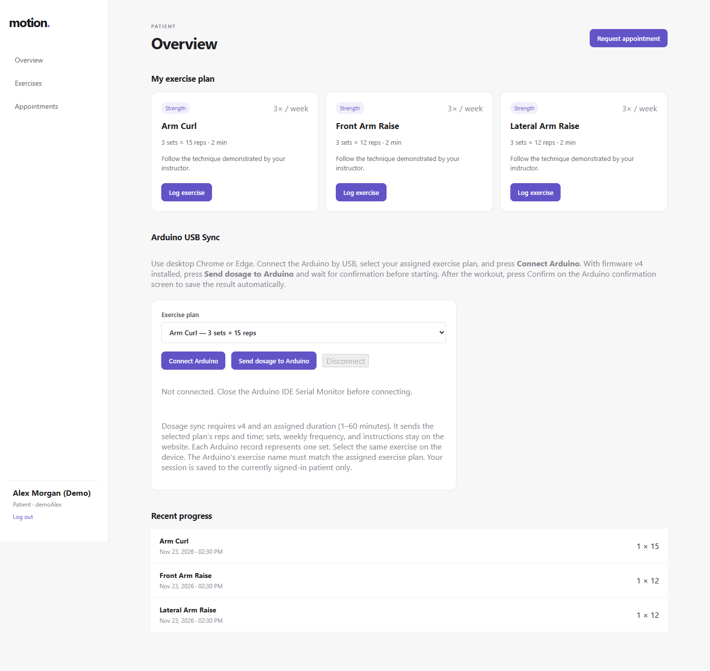
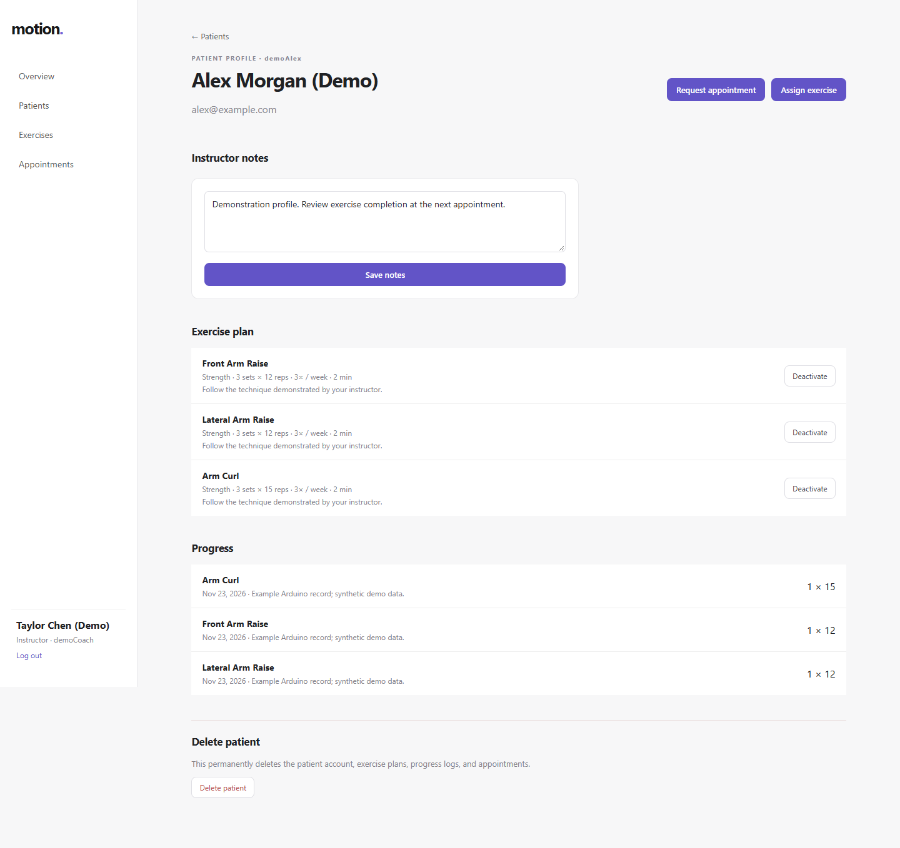
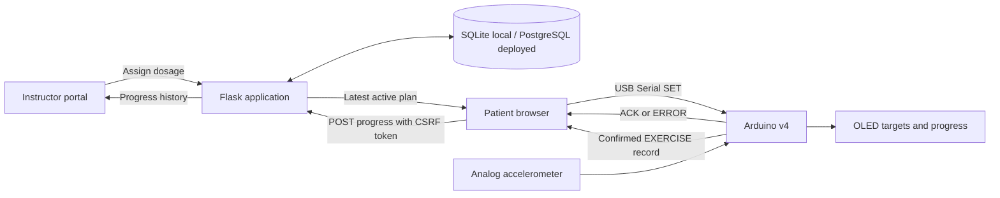
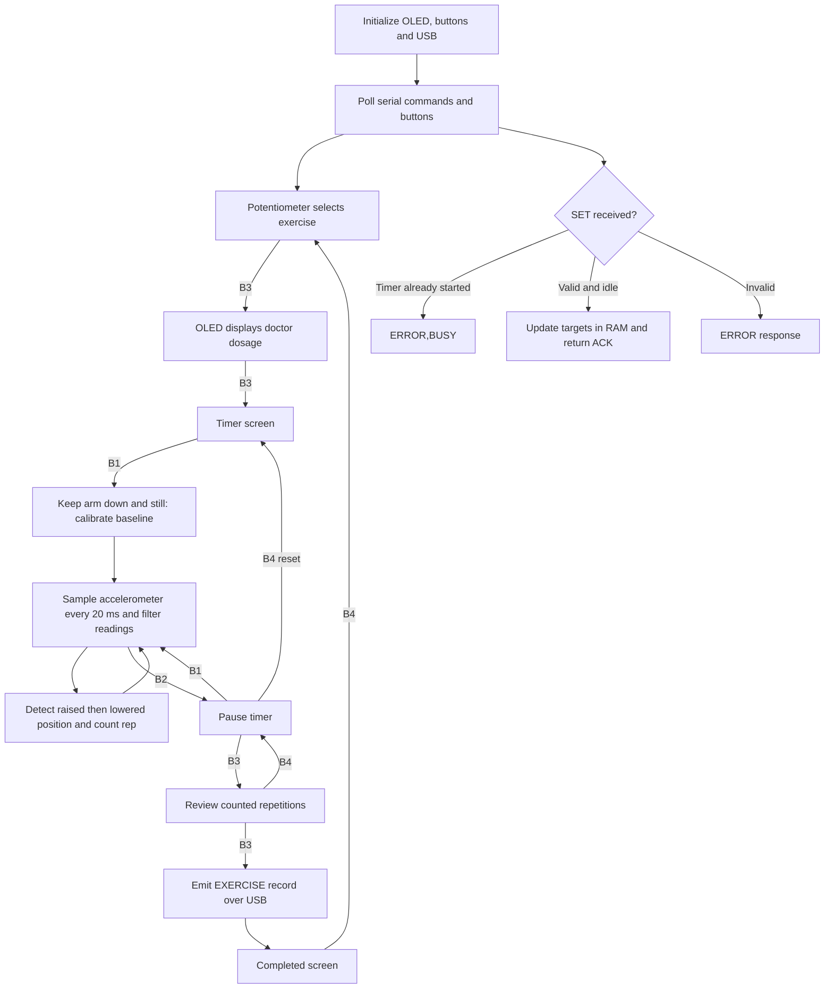
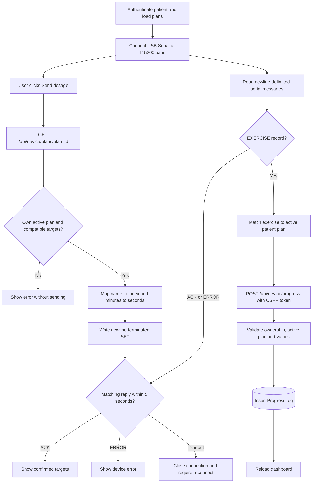
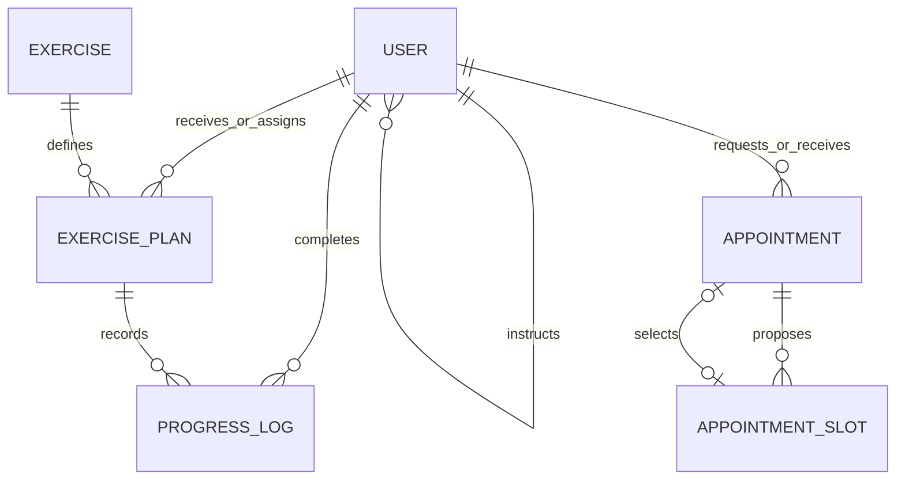

# CCCARE — Connected Exercise Tracking

CCCARE is an ECE198 exercise-tracking prototype connecting an Arduino motion sensor and OLED interface to **Motion**, our web portal. Instructors assign exercise dosage, patients complete exercises, and instructors review progress. The patient's browser bridges the website and Arduino over USB.

## Product and features

| Component | Features |
| --- | --- |
| Instructor | Approve linked patients, assign exercise plans, review progress and maintain private notes. |
| Patient | View assigned reps, sets, duration and frequency; send dosage to Arduino v4; upload device records or log progress manually. |
| Appointments | Request appointments, propose times, accept, counter, decline or cancel. |
| Administration | Manage instructor and patient accounts. |
| Arduino v4 | Select exercises, display dosage, calibrate the sensor, count reps, time sessions and exchange USB messages. |
| Database | Persist accounts, exercises, plans, progress and appointments in SQLite locally or PostgreSQL when deployed. |

## Website screenshots

Actual local application pages using synthetic demonstration accounts and records. These show the repository implementation, not a verified production deployment or physical device connection.

### Patient overview and USB synchronization



### Instructor patient profile



## Overall system flow



The UNO R4 Minima does not connect directly to the hosted database. The patient must sign in on a computer, connect the device and keep the browser open. Saving an instructor plan does not automatically push it to a disconnected device.

## Hardware and firmware

Use [firmware v4](firmware/v4/CCCARE_Arduino/CCCARE_Arduino.ino) for bidirectional dosage synchronization. V1–V3 remain available as earlier versions.

| Component | Connection / behavior |
| --- | --- |
| Arduino | UNO R4 Minima; USB Serial at 115200 baud; 10-bit analog readings |
| OLED | 128 × 64 I²C display at 0x3C; Wire, Adafruit GFX and Adafruit SSD1306 libraries |
| Potentiometer | A0; exercise selection |
| Analog accelerometer | X on A1, Y on A2, Z on A3; match supply and wiring to the actual sensor |
| B1 / B2 | D3 Start or Resume / D4 Pause |
| B3 / B4 | D5 Select, Next, Done or Save / D6 Back, Reset or New exercise |
| Buttons | INPUT_PULLUP; pressed state is LOW; action depends on the current screen |

### Hardware flowchart



Counting uses changes in accelerometer ADC readings, not measured joint angles. Filtering, separate raise/lower thresholds, a 150 ms position hold and a 600 ms minimum rep interval reduce false counts. Target time is guidance; the timer does not automatically end the session at that target. Sensor placement and counting accuracy require physical validation.

## Sending instructor dosage to Arduino

1. Flash v4 and close Arduino IDE Serial Monitor so the browser can open the port.
2. The instructor assigns **Arm Curl**, **Front Arm Raise**, or **Lateral Arm Raise**, with **1–1000 reps** and **1–60 minutes** duration.
3. Sign in as the assigned patient using desktop Chrome or Edge on HTTPS, or localhost for development. Reload the dashboard if a new plan was just assigned.
4. Under **Arduino USB Sync**, select the plan, click **Connect Arduino**, and choose the USB device.
5. Click **Send dosage to Arduino**. The browser fetches the latest saved plan, converts minutes to seconds, sends it and waits for an acknowledgement. Check the page confirmation and OLED targets before starting.
6. Select the same exercise on Arduino. Press B3 to view dosage, B3 again for the timer, then B1 to calibrate and start. Pause with B2; B3 opens review and B3 saves the record.
7. The browser uploads the result to the signed-in patient's plan and reloads the dashboard. Reconnect for another session.

Only **reps and duration for one set** transfer to v4. Sets, weekly frequency and instructions remain on the website. Each uploaded record counts as one set. Targets are stored in RAM and revert to firmware defaults after a reset; resend after reconnecting.

### Serial protocol

| Direction | Example | Meaning |
| --- | --- | --- |
| Browser → Arduino | `SET,0,20,120` followed by a newline | Arm Curl, 20 reps, 120 seconds |
| Arduino → browser | `ACK,0` | Command accepted for exercise 0 |
| Arduino → browser | `ERROR,BUSY` | Timer has started; pausing alone does not allow dosage changes |
| Arduino → browser | `ERROR,INVALID`, `ERROR,FORMAT`, `ERROR,TOO_LONG` | Command rejected |
| Arduino → browser | `EXERCISE,Arm Curl,TARGET_REPS,20,ACTUAL_REPS,18,TARGET_SECONDS,120,ACTUAL_SECONDS,110` | Confirmed session record |

Firmware indices are **0 = Arm Curl, 1 = Front Arm Raise, 2 = Lateral Arm Raise**, not database primary keys. The server maps names to indices. Unsupported exercises and missing or out-of-range targets are rejected without sending a command.

The browser allows two seconds for startup and waits up to five seconds for the matching ACK. A timeout closes the connection so a late reply cannot confirm a later request. For BUSY, finish the session or reset with B4 on the timer/completed screen, then resend. Resetting an unsaved workout discards it.

### Software flowchart



### Why the previous download path failed

The browser bridge read serial records and posted progress but never opened a serial writer or sent `SET`. V4 already implemented the receiver. The updated bridge adds the missing write path and ACK/error handling. The patient-only API validates ownership and maps names and units before transmission.

## Database

SQLAlchemy models are defined in [app.py](Web%20%26%20Database/app.py).

| Table | Stored data |
| --- | --- |
| `user` | Login ID, password hash, role, approval, linked instructor, contact details and private notes |
| `exercise` | Exercise name, category and description |
| `exercise_plan` | Patient, instructor, exercise, sets, reps, minutes, frequency, instructions and active status |
| `progress_log` | Patient and plan, timestamp, completed sets, reps, duration and notes |
| `appointment` | Requester, recipient, status, note and selected time slot |
| `appointment_slot` | Proposed start time and parent appointment |



- **Local:** SQLite at `Web & Database/instance/database.db` when `DATABASE_URL` is unset.
- **Hosted:** `DATABASE_URL` selects PostgreSQL through psycopg. Render configuration references `ece198-motion-demo-db`.
- USB uploads store one set per record. Exact seconds are retained in notes; duration stores rounded-up minutes (zero duration remains unset).
- Records belong to the authenticated patient, not an Arduino-supplied patient ID. Instructors access linked patients; patients access their own plans. POST requests require CSRF protection.
- Startup creates missing tables, not schema migrations. Database contents and credentials are not included in this repository.

## Running the web application

Use Python 3.12, create and activate a virtual environment, then run:

```text
cd "Web & Database"
python -m pip install -r requirements.txt
python app.py
```

Set `MOTION_ADMIN_PASSWORD` to at least 12 characters before first startup to provision the admin account. Set a private `MOTION_SECRET_KEY` for persistent sessions. With `DATABASE_URL` configured, a secret key and initial admin password are required. Store credentials in environment variables. Use the admin interface to create instructors; patients register and await instructor approval.

### Deployment configuration

[render.yaml](render.yaml) names `ece198-motion-demo`, but currently points to **`milinkaa/ECE198`, branch `render-demo`**, rather than this repository's `main`. The repository contains no explicit public website URL; read the actual URL from the Render dashboard. Updating this repository alone does not establish that the hosted app received the fix. Deploy this revision through the service's configured source, or deliberately update that source, preserving its database and environment variables.

## Verification

```text
cd "Web & Database"
python -m pip install -r requirements-dev.txt
python -m pytest
node --test tests/arduino-sync.test.cjs
```

Tests cover role and ownership restrictions, latest prescription values, mappings and bounds, serial writes, matching and fragmented ACKs, BUSY and timeout handling, and the existing upload path. Serial tests simulate a device. Physical acceptance requires comparing OLED targets with a plan, completing a real exercise and checking saved progress in both patient and instructor views.

## Repository guide

- [Arduino v4](firmware/v4/CCCARE_Arduino/CCCARE_Arduino.ino)
- [Web application and database](Web%20%26%20Database/)
- [Hardware testing notes](docs/Hardware_Testing.md)
- [Accelerometer test](tests/Accelerometer_Test/Accelerometer_Test.ino)
- [OLED test](tests/OLED_Test/OLED_Test.ino)
- [Potentiometer test](tests/Potentiometer_Test/Potentiometer_Test.ino)
